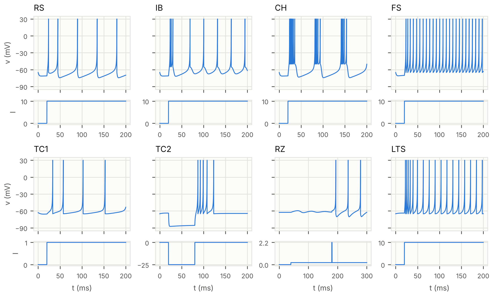

# Izhikevich Neuron Model — Neural Networks 2026, Assignment 1

Numerical simulation of the Izhikevich (2003) spiking neuron model: a single neuron integrated with **4th-order Runge-Kutta (RK4)** and, as an optional part, a **network of 1000 neurons** with noise integrated with **Euler-Maruyama**.

Assignment 1 for the *Neural Networks 2026* course — FaMAF, Universidad Nacional de Córdoba (Argentina).

**English versions:** [report (PDF)](informe/english/izhikevich_report_EN.pdf) · [notebook](notebooks/TP1_Izhikevich_EN.ipynb) — the notebook also includes Part 2 (the network).



*The eight firing patterns from Figure 2 of the paper, reproduced with RK4: membrane potential `v` (top) and input current `I` (bottom) for each neuron type.*

---

## The model

The model reduces Hodgkin-Huxley dynamics to two equations (same notation as the report, the code and the original paper):

```
dv/dt = 0.04·v² + 5·v + 140 − u + I(t)
du/dt = a·(b·v − u)

if v ≥ 30 mV  →  v ← c,   u ← u + d
```

| Symbol | Meaning |
|---|---|
| `v` | Membrane potential (mV) |
| `u` | Recovery variable (K⁺ activation / Na⁺ inactivation) |
| `I(t)` | External input current |
| `a` | Time scale of `u` (recovery speed) |
| `b` | Sensitivity of `u` to subthreshold fluctuations of `v` |
| `c` | Reset value of `v` after a spike (mV) |
| `d` | Increment of `u` after a spike |

> Note: the earlier version of the assignment (Sept 24) used `b, c, v−, Δu` instead of `a, b, c, d`. That notation only appears in `simulaciones/codigo/figuras_teoria.py`.

---

## Contents

### Part 1 — Single neuron

1. RK4 integration with step `h = 0.1` ms, reset when `v ≥ 30` mV, and initial condition `u(0) = b·v(0)`.
2. Base case on `t ∈ [0, 100]` ms with `v(0) = −70` mV (`u(0) = −14`) and step current `I₀`: `I = 0` if `t < 10`, `I = 10` if `t ≥ 10`.
3. Reproduction of the 8 firing patterns from Figure 2 of the paper, simulated for 200 ms (300 ms for RZ):

| Case | Name | a | b | c (mV) | d | v(0) (mV) | Current (t in ms) |
|---|---|---|---|---|---|---|---|
| Base | Base case | 0.02 | 0.2 | −65 | 2 | −70 | `I₀`: 0 (t < 10); 10 (t ≥ 10) |
| RS | Regular spiking | 0.02 | 0.2 | −65 | 8 | −65 | `I₁`: 0 (t < 20); 10 (t ≥ 20) |
| IB | Intrinsically bursting | 0.02 | 0.2 | −55 | 4 | −65 | `I₁` |
| CH | Chattering | 0.02 | 0.2 | −50 | 2 | −65 | `I₁` |
| FS | Fast spiking | 0.1 | 0.2 | −65 | 2 | −65 | `I₁` |
| TC1 | Thalamo-cortical (depolarized) | 0.02 | 0.25 | −65 | 0.05 | −63 | `I₂`: 0 (t < 20); 1 (t ≥ 20) |
| TC2 | Thalamo-cortical (hyperpolarized) | 0.02 | 0.25 | −65 | 0.05 | −65 | `I₃`: 0 (t < 20); −25 (20 ≤ t < 80); 0 (t ≥ 80) |
| RZ | Resonator | 0.1 | 0.26 | −65 | 2 | −62.5 | `I₄`: 0 (t < 40); 0.2 (40 ≤ t < 180); 2.2 (180 ≤ t < 181); 0.2 (t ≥ 181) |
| LTS | Low-threshold spiking | 0.02 | 0.25 | −65 | 2 | −65 | `I₁` |

4. Numerical error: the base case is rerun with `h = 0.2, 0.05, 0.01` ms, using `h = 0.01` as the reference.

### Part 2 — Neuron network

- Python translation of the paper's MATLAB code.
- 800 excitatory + 200 inhibitory neurons with heterogeneous parameters (`r_i ~ U[0,1]`).
- Connection matrix: `a_ij = 0.5·r_ij` (excitatory) and `a_ij = −r_ij` (inhibitory).
- Gaussian noise (σ = 5 excitatory, σ = 2 inhibitory) integrated with Euler-Maruyama.
- Heaviside step replaced by `z(v) = (87 + v)/450 − 0.0193`.
- Reproduction of Figure 3 of the paper (spike raster plot).

---

## Repository structure

```
izhikevich-neuron-model/
├── README.md
├── requirements.txt
├── docs/
│   └── eight_firing_patterns.png   # figure shown in this README
├── informe/
│   ├── grupo36_mariel_anachuri_camila_giolitto_martin_robins_tp1.pdf   # submitted report (Spanish)
│   ├── latex/                 # LaTeX source of the report (main.tex + figuras/)
│   └── english/
│       ├── izhikevich_report_EN.pdf   # English version of the submitted report
│       └── latex/                     # its LaTeX source (REVTeX 4.2: main.tex, references.bib, figures/)
├── notebooks/
│   ├── TP1_Izhikevich.ipynb      # group's final notebook (Spanish)
│   └── TP1_Izhikevich_EN.ipynb   # English version: Part 1 step by step, integration-step error, Part 2 (network)
├── simulaciones/
│   ├── codigo/                # modules and scripts that generate the figures
│   │   ├── izhikevich.py          # model, RK4/Euler, currents I1–I4, reset
│   │   ├── red_izhikevich.py      # 1000-neuron network (Euler-Maruyama)
│   │   ├── figuras.py             # regenerates figs/ and resultados.json
│   │   ├── figuras_teoria.py, figuras_rk4.py        # figures for the study guides
│   │   ├── figura_ocho_casos_informe.py, figura_red_informe.py
│   │   └── resultados.json        # spike times and metrics
│   ├── figs/                  # generated figures
│   └── tp1_izhikevich.ipynb   # extended notebook (additional analysis)
└── guias/                     # HTML study guides (open in a browser)
```

### How to run

```bash
pip install -r requirements.txt
cd simulaciones/codigo
python figuras.py              # regenerates ../figs/*.png and resultados.json (~90 s)
python figuras_teoria.py       # theory figures in ../figs/teoria/
python figuras_rk4.py
python figura_ocho_casos_informe.py output.png   # 2x4 figure of the eight firing types (300 dpi)
python figura_red_informe.py output.png
```

Open the notebooks with `jupyter notebook notebooks/TP1_Izhikevich.ipynb` (Spanish) or `jupyter notebook notebooks/TP1_Izhikevich_EN.ipynb` (English, includes Part 2).

---

**Dependencies:** Python 3.10+, `numpy`, `scipy`, `matplotlib`, `jupyter`.

> The original coursework (submitted report, notebooks, study guides and code comments) is in Spanish. The English report is a translation of the submitted report; the English notebook is a translation of the group notebook, with Part 2 added.

---

## References

1. Izhikevich, E. M. (2003). *Simple model of spiking neurons*. IEEE Transactions on Neural Networks, 14(6), 1569–1572.
2. Izhikevich, E. M. (2006). *Dynamical Systems in Neuroscience: The Geometry of Excitability and Bursting*. MIT Press.
3. Hodgkin, A. L., & Huxley, A. F. (1952). *A quantitative description of membrane current and its application to conduction and excitation in nerve*. The Journal of Physiology, 117(4), 500–544.

---

Instructors: Francisco Tamarit, Juan Perotti, Tristán Osán, Franco Milana.
